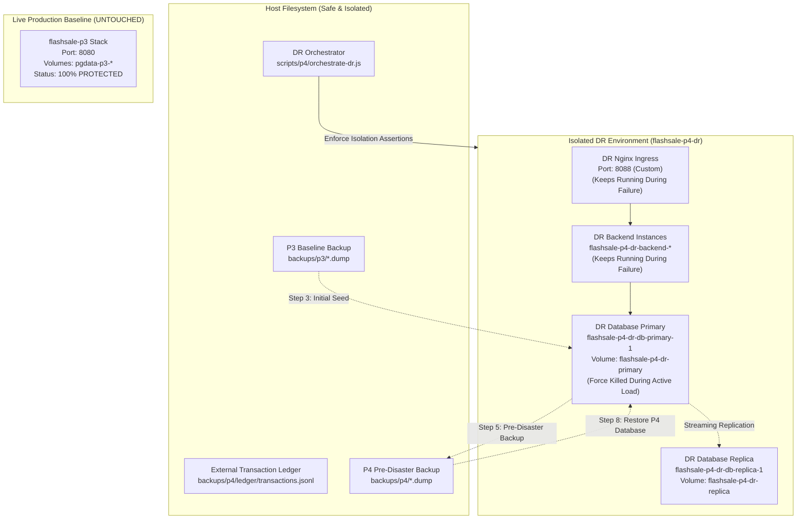
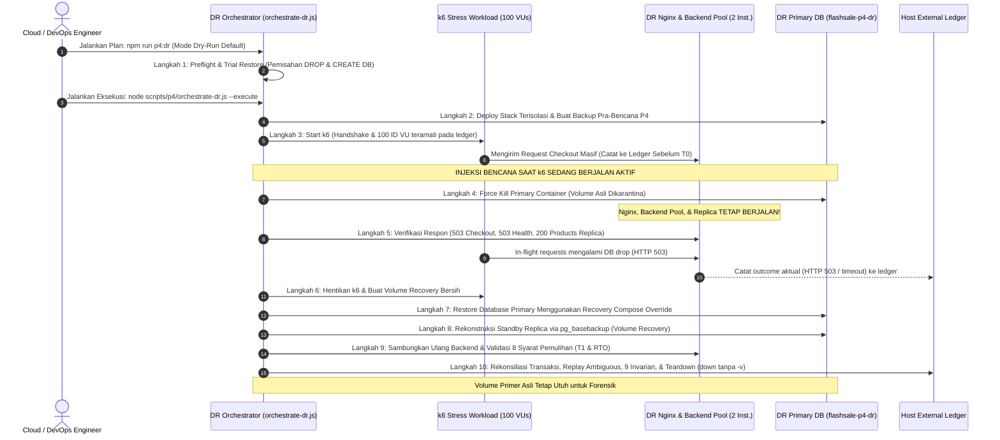

# Pertemuan 4: Otomasi Backup dan Restore Database (Disaster Recovery Plan)

> **Hasil terbaru, 9 November 2026 WIB: PASSED.** Run `27f60e05265e` memakai restore snapshot ditambah rekonstruksi ACK dari ledger dengan persetujuan eksplisit sebelum eksperimen. RTO 107,395 detik; RPO sebelum replay 0,075 detik; 431 ACK direkonsiliasi, unresolved 0; 100 request ambigu terselesaikan. Semua gate teknis dan bisnis lulus. Snapshot awal tetap tercatat kehilangan 431 ACK; hasil historis sebelumnya tetap FAILED/PARTIAL. Bukti utama: `results/p4/27f60e05265e/report.json`. Opsi, audit dan batas klaim dijelaskan pada bagian terbaru [P4_REVIEW_CORRECTIONS.md](P4_REVIEW_CORRECTIONS.md).

Koreksi sebelum DR ulang: [P4_REVIEW_CORRECTIONS.md](P4_REVIEW_CORRECTIONS.md). K6 menolak respons tidak diharapkan; 100 observed VUs hanya bukti partisipasi ledger; guard restore berlaku pada API; cleanup transactional checkout menjadi opt-in dan memakai shared lock. Regresi Python belum dijalankan karena interpreter tidak tersedia.

> **Hasil DR aktual 8 November 2026: FAILED.** Run `results/p4/03bf75dd3f2c` mencatat 390 ACK sebelum injeksi tidak ditemukan di recovery, ditambah 19 ACK terlambat: total 409 ACK hilang dari hasil restore awal. Kedua backend crash akibat event error PostgreSQL Client yang tidak ditangani; ingress memberi 502 sehingga T0 dua health 503 tidak terdeteksi. RPO historis 0,037 detik tidak membuktikan integritas transaksi. Keberadaan 19 order terlambat pada volume primary asli belum dibuktikan. Laporan asli dipertahankan. Perbaikan, prosedur forensik, rekonsiliasi, syarat sukses dan hasil regresi terbaru dijelaskan dalam [P4_POST_FAILURE_HARDENING.md](P4_POST_FAILURE_HARDENING.md). Belum ada pengujian DR aktual ulang.

> **Acuan berlaku: Arsitektur P1 v1.3 dan DRP P1 v1.1.** Runbook P4 resmi saat ini adalah [P4_GOVERNING_ALIGNMENT.md](P4_GOVERNING_ALIGNMENT.md), dengan project `flashsale-p3`, `.env.p3`, dan endpoint `127.0.0.1:8080`. `npm run p4:dr` kini memeriksa jalur tersebut. Bagian lama di bawah dipertahankan sebagai riwayat pekerjaan; instruksi clone `flashsale-p4-dr`, pengaturan interval historis, restore ke volume asli, serta rumus RTO/RPO lamanya **tidak berlaku sebagai runbook resmi**. Jangan menjalankan perintah destruktif dari bagian historis.

**Kelompok 1 — Flash Sale E-Commerce System**

Default backup berlaku setiap **60 detik**. `BACKUP_INTERVAL_SECONDS` dapat mengubah interval efektif; durasi backup juga memengaruhi waktu siklus berikutnya. Interval ini **tidak menjamin RPO**. RPO aktual hanya dapat dihitung dari bukti transaksi acknowledged pada ledger eksternal dan perbandingannya dengan database hasil recovery. Runbook resmi serta urutan manifest/lock terbaru ada di [P4_GOVERNING_ALIGNMENT.md](P4_GOVERNING_ALIGNMENT.md).

Dokumen ini mendokumentasikan implementasi mekanisme otomasi backup dan restore database PostgreSQL pada stack **Pertemuan 3 (P3)** untuk mendukung strategi *Disaster Recovery Plan* (DRP).

---

## 1. Tujuan Backup dan Restore

1. **Kelangsungan Bisnis (*Business Continuity*)**: Memastikan data transaksi flash sale, katalog produk, dan pengguna dapat dipulihkan secara cepat dan akurat saat terjadi kegagalan sistem, korupsi data, atau kehancuran container database primary.
2. **Mitigasi Kehilangan Data (*RPO - Recovery Point Objective*)**: Membatasi batas toleransi data yang hilang dengan target awal perancangan maksimal 1 menit melalui backup berkala serial setiap 60 detik.
3. **Kecepatan Pemulihan (*RTO - Recovery Time Objective*)**: Menetapkan target awal perancangan waktu pemulihan hingga database siap melayani transaksi kembali dalam waktu kurang dari 5 menit.
4. **Integritas dan Konsistensi Data**: Menjamin konsistensi snapshot relasional (tabel `orders`, `products`, `users`) tanpa terjadi anomali stok negatif atau pesanan tak bertuan, sekalipun backup dieksekusi saat lonjakan transaksi checkout sedang berlangsung.
5. **Isolasi Antar-Stack**: Menjamin seluruh prosedur backup dan restore hanya menargetkan database stack P3 (`flashsale_p3`), tanpa menyentuh atau mengontaminasi stack P2 (`flashsale`).

---

## 2. Arsitektur Backup

Arsitektur backup dan restore dirancang dengan prinsip **fail-closed** dan **least privilege**:

```mermaid
graph TD
    subgraph Host["Host Lingkungan (Windows PowerShell / Git Bash)"]
        CronLoop["Backup Loop (60s interval)<br/>scripts/p4/backup-loop.sh -> backup-loop.js"]
        BackupCLI["Backup Automation<br/>scripts/p4/backup.sh -> backup.js"]
        RestoreCLI["Restore Automation<br/>scripts/p4/restore.sh -> restore.js"]
        BackupStorage["Storage Backup Host<br/>backups/p3/*.dump<br/>backups/p3/*.sha256<br/>backups/p3/*.meta.json"]
        LockFile["Atomic Lock File (flag: 'wx')<br/>backups/p3/.backup.lock"]
    end

    subgraph Docker["Docker Engine (flashsale-p3)"]
        Primary["Container Primary (Writer)<br/>flashsale-p3-db-primary-1<br/>Database: flashsale_p3"]
        Replica["Container Replica (Standby)<br/>flashsale-p3-db-replica-1"]
        Backends["Backend Instances (2-6)<br/>flashsale-p3-backend-*"]
    end

    CronLoop -->|Acquire Atomic Lock| LockFile
    CronLoop -->|Trigger Sequential| BackupCLI
    BackupCLI -->|1. Inspect Labels & Role Check| Primary
    BackupCLI -->|2. pg_dump -Fc (Snapshot REPEATABLE READ)| Primary
    Primary -->|3. Docker cp to Host (.tmp)| BackupStorage
    BackupCLI -->|4. pg_restore --list (Validate TOC)| Primary
    BackupStorage -->|5. Finalize .dump + SHA-256 + Meta| BackupStorage

    RestoreCLI -->|Validate Checksum & TOC| BackupStorage
    RestoreCLI -->|Terminate Active Conns (--execute)| Primary
    RestoreCLI -->|pg_restore --clean --if-exists| Primary
    RestoreCLI -->|Fail-Closed Post-Restore Verification| Primary
```

### Karakteristik Snapshot Konsisten
- **Custom Format (`-Fc`)**: Menggunakan format biner arsip PostgreSQL terkompresi yang mendukung kompresi zlib, metadata TOC (*Table of Contents*), serta fleksibilitas seleksi objek saat restore.
- **Konsistensi ACID Saat Checkout Berlangsung**: `pg_dump` secara otomatis membuka satu transaksi berisolasi `REPEATABLE READ`. Seluruh data yang diekspor terkunci secara konsisten pada satu titik waktu awal snapshot tanpa memblokir pembaca (*readers*) maupun penulis (*writers* / transaksi checkout). Sistem tidak mengklaim isolasi `SERIALIZABLE` karena konfigurasi tersebut tidak diaktifkan secara eksplisit pada engine database.

---

## 3. Mekanisme Backup Otomatis

Implementasi skrip backup (`scripts/p4/backup.js` dan wrapper `scripts/p4/backup.sh`) menjalankan tahapan berikut:

1. **Validasi Identitas Container (Fail-Closed)**:
   - Memeriksa bahwa container `flashsale-p3-db-primary-1` berjalan aktif.
   - Memvalidasi label Docker Compose:
     - `com.docker.compose.project = flashsale-p3`
     - `com.docker.compose.service = db-primary`
     - `flashsale.environment = p3`
2. **Validasi Database & Peran Writer**:
   - Menjalankan `SELECT current_database(), pg_is_in_recovery()`.
   - Memastikan nama database strictly `flashsale_p3` (menolak database `flashsale` milik P2).
   - Memastikan `pg_is_in_recovery() = 'f'` (menolak backup dari replica/standby).
3. **Atomic Write Menggunakan Temporary File**:
   - Dump pertama kali ditulis ke `/tmp/backup_<timestamp>.dump` di dalam container.
   - Disalin ke host sebagai file sementara: `backups/p3/flashsale_p3_<timestamp>.dump.tmp`.
   - File temporary di container langsung dibersihkan.
4. **Validasi Integritas Arsip (TOC Check)**:
   - Menjalankan `pg_restore --list` terhadap file `.tmp`.
   - Jika daftar objek (tabel, relasi, constraint) tidak terbaca atau header korup, file `.tmp` langsung dihapus dan proses dibatalkan.
5. **Finalisasi & Metadata**:
   - File `.tmp` di-rename secara atomik menjadi file final `.dump`.
   - Menghitung nilai hash SHA-256 dari file final dan menyimpannya di file `.dump.sha256`.
   - Menulis metadata lengkap (`.dump.meta.json`): ukuran file, SHA-256, jumlah entitas TOC, waktu mulai, waktu selesai, dan durasi dalam milidetik.
   - Mencatat keberhasilan ke `backups/p3/backup.log`.
6. **Perlindungan Backup yang Sudah Ada**:
   - Jika backup mengalami kegagalan, backup sebelumnya **tidak pernah dihapus** dan tetap aman di direktori penyimpanan.

---

## 4. Mekanisme Backup Loop & Atomic Lock

Skrip `scripts/p4/backup-loop.js` (dan wrapper `scripts/p4/backup-loop.sh`) mengimplementasikan otomasi berkala yang tangguh:

1. **Pembuatan Lock Eksklusif Atomik Sebelum Loop**:
   - Lock file (`backups/p3/.backup.lock`) diperoleh secara atomik sebelum memasuki siklus `while` loop menggunakan opsi Node.js `{ flag: "wx" }` (setara `O_CREAT | O_EXCL` POSIX).
   - Jika lock file sudah ada, kernel sistem operasi langsung menolak pembuatan dengan kode error `EEXIST`, dan proses baru ditolak tanpa menjalankan backup ganda.
   - Isi lock file menyimpan JSON `{ pid, createdAt }`.
2. **Retensi Lock Selama Seluruh Siklus & Masa Jeda**:
   - Atomic lock dipertahankan secara terus-menerus selama proses loop aktif, termasuk saat proses sedang dalam masa jeda (`sleep`) menunggu interval 60 detik berikutnya. Hal ini menjamin dua proses loop tidak dapat bergantian mengambil lock di sela interval.
3. **Perlindungan Kepemilikan Lock & Pelepasan Fail-Safe**:
   - Pelepasan lock dibungkus dalam blok `try ... finally` pada lifecycle loop.
   - Lock file hanya dapat dihapus oleh proses yang memilikinya (`releaseLock(lockFile, myPid)`). Proses asing yang bukan pemilik dilarang keras menghapus lock.
4. **Perhitungan Interval Adaptif & Pencegahan Proses Paralel**:
   - Loop mencatat durasi eksekusi backup dan menghitung sisa waktu tidur:
     `remainingSleepMs = Math.max(0, (intervalSeconds * 1000) - cycleDurationMs)`
   - Jika backup berlangsung lebih lama daripada interval (misal backup memakan waktu 75 detik pada interval 60 detik), proses tidak menjalankan backup secara paralel, melainkan melanjutkan ke siklus berikutnya secara serial tanpa penumpukan proses.
5. **Graceful Shutdown Tanpa Pemutusan Paksa**:
   - Menangani sinyal `SIGINT` (Ctrl+C) dan `SIGTERM` secara anggun.
   - Jika sinyal diterima saat backup sedang berlangsung, proses menunggu backup in-flight tersebut selesai terlebih dahulu sebelum melepaskan lock dan keluar. Jika sinyal diterima saat proses sedang tidur (*sleep*), timer dibangunkan seketika agar proses dapat keluar tanpa jeda berlebih.
   - Catatan pengujian: Validasi 1-iterasi loop hanya membuktikan satu siklus backup berjalan dengan aman, bukan pembuktian kestabilan eksekusi berulang dalam jangka waktu panjang.

---

## 5. Mekanisme Restore

Implementasi skrip restore (`scripts/p4/restore.js` dan wrapper `scripts/p4/restore.sh`) mengedepankan prinsip kehati-hatian:

1. **Default DRY-RUN (Simulasi Aman)**:
   - Menjalankan skrip tanpa parameter tambahan hanya melakukan inspeksi kelayakan dan pelaporan rencana pemulihan.
   - Tidak ada data, tabel, atau konfigurasi database yang dimodifikasi.
2. **Pemilihan Backup Terbaru yang Benar-Benar Valid**:
   - Fungsi `findLatestBackup()` memeriksa file `.dump` dari timestamp paling baru ke yang paling lama.
   - Setiap kandidat divalidasi secara berurutan: (1) keberadaan file `.sha256`, (2) kecocokan hash SHA-256, dan (3) integritas struktur arsip via `pg_restore --list`.
   - Jika backup terbaru korup atau belum memiliki checksum (misal proses backup sebelumnya terhenti di tengah jalan), skrip secara otomatis melewati kandidat tersebut dan memilih backup sebelumnya yang valid.
   - Seluruh file backup lama **tidak pernah dihapus atau dimodifikasi** selama proses pencarian.
   - Jika seluruh backup tidak valid, proses restore berhenti dengan pesan error yang jelas.
3. **Flag Eksplisit `--execute`**:
   - Restore aktual hanya dieksekusi jika operator menyertakan flag `--execute`.
4. **Validasi Target Database**:
   - Memastikan container target memiliki label `flashsale-p3`, `db-primary`, dan `p3`.
   - Memastikan database target adalah `flashsale_p3` dan berstatus writer (`in_recovery = 'f'`). Menolak keras database P2.
5. **Pemutusan Koneksi Backend Aktif & Validasi Ketat**:
   - Sebelum restore, koneksi aplikasi aktif diputus menggunakan `pg_terminate_backend`.
   - Query pemutusan koneksi memfilter `WHERE terminated = true` sehingga hanya menghitung koneksi yang benar-benar berhasil diputus.
   - Hasil parsing angka koneksi menggunakan fungsi `parseStrictNonNegativeInt` yang menolak string kosong, bilangan negatif, `0invalid`, `NaN`, atau `Infinity`. Query error tidak pernah diubah menjadi nilai default `0`.
   - Skrip melakukan **pemeriksaan ulang (*re-check*)**: jika masih terdapat koneksi yang menghalangi (misal akibat *connection pool reconnect*), restore langsung dibatalkan secara fail-closed.
6. **Opsi Restorasi `pg_restore`**:
   - `--clean`: Menghapus objek lama sebelum membuat ulang.
   - `--if-exists`: Menggunakan sintaks `DROP ... IF EXISTS` agar tidak error pada database baru.
   - `--no-owner`: Menghindari error hak kepemilikan user saat migrasi.
   - `--no-acl`: Mencegah modifikasi tabel hak akses (*grant/revoke*).
   - `--exit-on-error`: Langsung berhenti jika terjadi kesalahan query restorasi.
7. **Verifikasi Pasca-Restore Fail-Closed**:
   - Menjalankan query hitung baris: `orders_count`, `products_count`, `users_count`.
   - Hasil verifikasi diparse secara ketat: menolak output kosong, format bukan 3 kolom, `NaN`, pecahan, atau bilangan negatif.
   - Status `SUCCESS` hanya dikembalikan jika restorasi dan verifikasi pasca-restore sama-sama lolos.
8. **Proteksi Docker Volume**:
   - Skrip **tidak pernah menghapus atau mereset volume Docker**. Data dipulihkan secara in-place di dalam database PostgreSQL aktif.

---

## 6. Konsistensi Wrapper Bash dan Node.js

Untuk mencegah divergensi aturan validasi (*diverging validation logic*):
- Seluruh logika bisnis diimplementasikan secara terpusat pada modul Node.js (`scripts/p4/backup.js`, `backup-loop.js`, `restore.js`, `common.js`).
- Skrip shell Bash (`backup.sh`, `backup-loop.sh`, `restore.sh`) berfungsi sebagai **wrapper transparan** yang meneruskan seluruh argumen (seperti `--execute` dan `--file`) ke modul Node.js.
- Jika Node.js tidak tersedia pada lingkungan terminal, skrip Bash langsung berhenti dengan kode keluar `127` dan pesan kesalahan yang jelas, tanpa melemahkan validasi checksum, TOC, atau verifikasi pasca-restore.

---

## 7. Panduan Perintah Operasional

### A. Menjalankan Backup
```powershell
# Melalui npm (PowerShell / CMD)
npm.cmd run p4:backup

# Melalui Git Bash
bash scripts/p4/backup.sh

# Melalui Node.js langsung
node scripts/p4/backup.js
```

### B. Menjalankan Backup Berkala (60 Detik)
```powershell
# Melalui npm
npm.cmd run p4:backup-loop

# Melalui Git Bash
bash scripts/p4/backup-loop.sh

# Override interval efektif (contoh 90 detik; default 60 detik)
$env:BACKUP_INTERVAL_SECONDS="90"; npm.cmd run p4:backup-loop
```

### C. Menjalankan Simulasi Restore (Dry-Run Default)
```powershell
# Melalui npm (otomatis memilih backup terbaru)
npm.cmd run p4:restore

# Memilih file tertentu
node scripts/p4/restore.js --file backups/p3/flashsale_p3_YYYYMMDD_HHMMSS.dump

# Melalui Git Bash
bash scripts/p4/restore.sh
```

---

## 8. Prosedur Restore Aktual (9 Langkah Lengkap)

Bila terjadi skenario pemulihan bencana (DRP), ikuti 9 langkah berurutan berikut:

1. **Langkah 1 — Pastikan File Backup Valid**: Pastikan file `.dump` dan `.sha256` tersedia di direktori `backups/p3/`.
2. **Langkah 2 — Verifikasi SHA-256**: Skrip secara otomatis memvalidasi hash SHA-256 dari file arsip terhadap file checksum.
3. **Langkah 3 — Verifikasi TOC Arsip**: Skrip menjalankan `pg_restore --list` untuk membuktikan tabel dan constraint di dalam arsip dapat dibaca.
4. **Langkah 4 — Pastikan Container & Database Target Benar**: Container `flashsale-p3-db-primary-1` harus berjalan aktif dan database `flashsale_p3` berstatus writer (`in_recovery = 'f'`).
5. **Langkah 5 — Hentikan Sementara Trafik Backend P3 Sesuai Kebutuhan**: Karena Express connection pool dapat otomatis melakukan *reconnect*, hentikan sementara trafik request ke backend P3 (atau nonaktifkan routing upstream Nginx) untuk memastikan tidak ada koneksi baru yang masuk.
6. **Langkah 6 — Putuskan Koneksi Aktif**: Skrip memutus koneksi aktif via `pg_terminate_backend` dan melakukan verifikasi ulang bahwa tidak ada koneksi yang tersisa.
7. **Langkah 7 — Jalankan Restore Aktual**: Eksekusi restore dengan menyertakan flag eksplisit `--execute`:
   ```powershell
   node scripts/p4/restore.js --execute
   # atau: bash scripts/p4/restore.sh --execute
   ```
8. **Langkah 8 — Lakukan Verifikasi Pasca-Restore**: Skrip secara fail-closed memeriksa jumlah baris pada tabel `orders`, `products`, dan `users`.
9. **Langkah 9 — Pastikan Aplikasi Kembali Terhubung**: Hubungkan kembali backend dan periksa integritas invarian bisnis melalui endpoint `/stats`:
   ```powershell
   curl.exe -s http://127.0.0.1:8080/stats
   ```
   Pastikan output mengembalikan `"consistent": true` dengan `negative_stock: 0` dan `duplicate_orders: 0`.

---

## 9. Target RTO dan RPO

| Metrik DRP | Definisi | Target Awal Perancangan | Mekanisme Pendukung |
|:---|:---|:---|:---|
| **RPO (Recovery Point Objective)** | Batas toleransi kehilangan data transaksi maksimal | **<= 1 Menit (60 detik)** | Backup otomatis serial setiap 60 detik (`backup-loop.js`) dan external transaction ledger. |
| **RTO (Recovery Time Objective)** | Waktu maksimal pemulihan hingga database siap melayani kembali | **<= 5 Menit (300 detik)** | Custom dump format biner (`-Fc`), pg_restore dengan `--clean --if-exists`, pemutusan koneksi otomatis. |

> [!WARNING]
> Angka RTO (<= 5 menit) dan RPO (<= 1 menit) di atas merupakan **target perancangan arsitektur**. Skrip pemulihan dan verifikasi non-destruktif telah 100% tervalidasi melalui unit test suite (122 PASS). Simulasi eksekusi pemulihan bencana destruktif (*destructive disaster recovery test*) menggunakan container dan volume terisolasi `flashsale-p4-dr` berstatus **NOT EXECUTED (Awaiting explicit user authorization)**.

---

## 10. Kebijakan Retensi Backup (Retention Policy)

Untuk mencegah kepenuhan disk host (*disk saturation*) akibat akumulasi backup berkelanjutan, diimplementasikan mekanisme retensi otomatis terproteksi pada `scripts/p4/common.js` (`applyRetentionPolicy`):

1. **Kebijakan Retensi Hingga 10 Backup Valid Terbaru (*Retains up to 10 Valid Backups*)**:
   - Sistem mempertahankan **hingga 10 file backup valid terbaru** (`.dump`, `.sha256`, `.meta.json`).
   - Jika jumlah backup valid kurang dari atau sama dengan 10, seluruh backup dipertahankan tanpa penghapusan.
   - Ketika jumlah backup valid melebihi 10, skrip secara otomatis menghapus backup yang paling tua hingga tersisa 10 backup valid terbaru.
   - Kebijakan ini adalah **retensi atas** (maksimal 10 backup tersimpan), bukan jaminan ketersediaan minimal bila backup yang dibuat memang belum mencapai 10.
2. **Prinsip Perlindungan Fail-Safe**:
   - **Perlindungan Backup Terakhir**: Skrip dilarang keras menghapus backup valid terakhir, apa pun kondisinya.
   - **Pencegahan Pruning Saat Restore Aktif**: Memeriksa keberadaan file lock restore (`.restore.lock`). Jika proses restore sedang berjalan, pembersihan retensi ditangguhkan.
   - **Proteksi File Non-Dump & Temporary**: File `.tmp`, `.lock`, file log, atau file asing tidak pernah disentuh oleh proses retensi.
3. **Penghapusan Aman pada Sistem Operasi Windows (`safeUnlinkSync`)**:
   - Menghadapi sifat filesystem Windows di mana file handle yang baru ditutup dapat memicu error transien `EBUSY` atau `EPERM`, penghapusan file backup lama menerapkan *retry loop* eksponensial (hingga 5 kali percobaan) sebelum melempar kegagalan.

---

## 11. External Transaction Ledger & Validasi RPO Transaksional (Idempotency-Key)

Untuk mengukur metrik RPO secara akurat dan empiris (bukan sekadar asumsi selang waktu cron), sistem mengimplementasikan **External Transaction Ledger** (`scripts/p4/ledger.js`):

1. **Format Ledger Append-Only JSONL**:
   - Disimpan pada filesystem host di luar container dan volume Docker (`backups/p4/ledger/transactions.jsonl`).
   - Setiap baris mencatat event transaksi checkout secara atomik:
     ```json
     {
       "idempotencyKey": "tx-1731040000000-1-0",
       "timestamp": "2026-11-08T04:25:00.000Z",
       "productId": 1,
       "qty": 1,
       "status": 201,
       "outcome": "CREATED",
       "orderId": 98
     }
     ```
2. **Bebas Data Sensitif (PII-Free)**:
   - Ledger hanya mencatat data teknis (`idempotencyKey`, `timestamp`, `productId`, `qty`, `status`, `outcome`, `orderId`) tanpa menyimpan kredensial pengguna, kata sandi, atau nomor rekening.
3. **Penyelarasan dengan Generator Beban (K6 & Node Workload)**:
   - Modul `scripts/p4/workload.js` dan skenario K6 `tests/load/p4-dr-workload.js` memancarkan stream transaksi berformat `[LEDGER] {...}` yang ditangkap dan disimpan secara append-only ke ledger host.
4. **Validasi Transaksional Menggunakan Idempotency-Key**:
   - Evaluasi RPO **tidak hanya menghitung selisih timestamp mentah**, melainkan mencocokkan setiap transaksi logikal yang berhasil di-acknowledge (*acknowledged logical transactions*) terhadap tabel `orders` pada database yang berhasil dipulihkan.
   - **Hanya transaksi yang sukses di-acknowledge oleh server (HTTP 201 CREATED atau HTTP 200 DUPLICATE) yang dihitung sebagai ekspektasi transaksi yang dapat dipulihkan (*recoverable transaction expectations*)**.
   - Transaksi gagal (HTTP 5xx, timeout, status 0, atau HTTP 409 SOLD_OUT) tidak pernah dihitung sebagai ekspektasi pesanan yang dapat dipulihkan.
   - **Laporan Evaluasi Transaksional Meliputi**:
     - **Acknowledged Transactions**: Jumlah dan daftar kunci transaksi yang berhasil diterima klien.
     - **Restored Transactions**: Transaksi yang berhasil ditemukan kembali di database pasca-restorasi.
     - **Missing Acknowledged Transactions**: Transaksi acknowledged yang hilang akibat bencana sebelum sempat ter-backup.
     - **Duplicate Transactions**: Deteksi anomali jika terdapat duplikasi `idempotency_key` di database orders.
     - **Last Recoverable Acknowledged Transaction**: Transaksi pulih terbaru beserta timestamp-nya.
     - **Actual RPO relative to failure timestamp**:
       $$\text{RPO}_{\text{actual}} = \max\left(0, \frac{T_{\text{failure}} - T_{\text{last\_restored}}}{1000}\right)$$

---

## 12. Arsitektur Isolasi Pengujian Disaster Recovery (flashsale-p4-dr)

Pengujian simulasi bencana dilarang keras mengorbankan atau mengotori lingkungan praktikum P3 (`flashsale-p3`) maupun P2 (`flashsale`). Oleh karena itu, disediakan infrastruktur isolasi khusus pada file `docker-compose.p4-dr.yml`:



### Parameter Isolasi Lingkungan DR:
- **Compose Project Name**: `flashsale-p4-dr`
- **Network Name**: `flashsale-p4-dr` (subnet terisolasi berlabel `flashsale.environment: p4-dr`)
- **Ingress Port**: `8088` (menghindari tabrakan dengan port 8080 milik P3 dan port 3000/5432 milik P2)
- **Volume Persisten DR**: `flashsale-p4-dr-primary` dan `flashsale-p4-dr-replica`
- **Enforcement Fail-Closed (`assertDrIsolation`, `assertDrVolumeIsolation`, `assertDrNetworkIsolation`)**:
  - Memeriksa label `com.docker.compose.project === "flashsale-p4-dr"`.
  - Memeriksa label `flashsale.environment === "p4-dr"`.
  - Memeriksa prefix nama volume dan network (`flashsale-p4-dr`).
  - Menolak keras operasi jika mendeteksi kontainer, volume, atau network milik stack P3 (`flashsale-p3`) atau P2 (`flashsale`).
  - Seluruh perintah compose pembersihan menggunakan flag tanpa `-v`:
    `docker compose -p flashsale-p4-dr -f docker-compose.p4-dr.yml -f docker-compose.p4-dr.recovery.yml down`
  - Volume primer asli `flashsale-p4-dr-primary` **dijamin tetap bertahan (survives) melewati seluruh siklus pengujian dan teardown** untuk inspeksi forensik. Volume recovery (`flashsale-p4-dr-primary-recovery` dan `flashsale-p4-dr-replica-recovery`) dibersihkan secara terpisah setelah verifikasi label yang ketat.

---

## 13. Konsistensi Dataset & Alur Kerja 10 Langkah DR Orchestration

Sesuai dokumen acuan **DRP Awal Kelompok 1 v1.2** dan **Spesifikasi Arsitektur v1.4**, skenario bencana utama adalah **forced failure pada container database primary saat stress testing checkout k6 sedang aktif berjalan**.

### Prinsip Penyelarasan Skenario Bencana Pertemuan 1:
1. **Kegagalan Container vs Kerusakan Volume**:
   - Pada skenario kegagalan container primary, **volume database asli (`flashsale-p4-dr-primary`) TETAP DIPERTAHANKAN dan DIKARANTINA** untuk keperluan investigasi forensik; volume asli **TIDAK DIHAPUS**.
   - Pemulihan database dilakukan menggunakan **volume pemulihan bersih baru (`flashsale-p4-dr-primary-recovery`)** dari arsip backup terverifikasi menggunakan file override `docker-compose.p4-dr.recovery.yml`.
   - Standby replica dibangun ulang menggunakan **volume pemulihan bersih baru (`flashsale-p4-dr-replica-recovery`)** melalui mekanisme streaming `pg_basebackup`.
2. **Perbedaan Restorasi Backup vs Failover Replika Manual**:
   - **Failover P1/P2**: Berfokus pada promosi instan standby replica menjadi primary baru melalui `pg_promote()` saat terjadi kegagalan primary.
   - **Disaster Recovery P4**: Berfokus pada rekonstruksi penuh primary dari file snapshot backup biner (`-Fc`) ke dalam volume bersih terisolasi, diikuti rekonstruksi menyeluruh replica dari primary yang telah pulih.
3. **Perilaku HTTP Invarian Selama Primary Outage**:
   - `POST /checkout` $\rightarrow$ **HTTP 503 (`DB_UNAVAILABLE`)**: Backend Express mendeteksi database write terputus dan fail-closed.
   - `GET /health` $\rightarrow$ **HTTP 503 (`status: "degraded", db: "down", replica: "up"`)**: Healthcheck mendeteksi kegagalan koneksi primary.
   - `GET /products` $\rightarrow$ **HTTP 200 (`X-Read-From: replica`)**: Trafik pembacaan katalog tetap 100% dapat dilayani oleh standby replica melalui Nginx.
4. **Metrik Waktu Empiris (T0, T1, RTO, RPO)**:
   - **$T_0$ (Failure Injection)**: Waktu saat container primary dimatikan paksa (`docker rm -f flashsale-p4-dr-db-primary-1`).
   - **$T_1$ (Recovery Fully Validated)**: Waktu saat sistem pulih sepenuhnya. Dicatat **HANYA jika seluruh 8 syarat berikut terpenuhi**:
     - Endpoint `/health` mengembalikan HTTP 200 (`status: "ok", db: "up", replica: "up"`).
     - Transaksi checkout baru berhasil dengan HTTP 201 (`CREATED`).
     - Endpoint `/stats` mengonfirmasi `consistent: true` (0 stok negatif, 0 duplikasi).
     - Query role primary memverifikasi `pg_is_in_recovery() = false`.
     - Query role replica memverifikasi `pg_is_in_recovery() = true`.
     - Replikasi streaming aktif (`health.replica === "up"`).
     - Nginx read routing terverifikasi (`X-Read-From: replica` pada HTTP 200).
     - Sembilan invarian data bisnis terpenuhi sempurna.
   - **$\text{RTO} = T_1 - T_0$** (Target perancangan: $\le 300\text{ detik} / 5\text{ menit}$).
   - **$\text{RPO} = \max(0, T_{\text{failure}} - T_{\text{last\_restored\_tx}})$** (Target perancangan: $\le 60\text{ detik} / 1\text{ menit}$).
   - Catatan: Ledger transaksi kosong **dilarang keras** diinterpretasikan sebagai bukti RPO = 0.
5. **Replay Transaksi Ambiguous & 9 Invarian Bisnis**:
   - Transaksi in-flight yang menerima respons ambigu (HTTP 503 atau timeout saat kegagalan diinjeksi) di-replay pasca-pemulihan menggunakan `Idempotency-Key` asli.
   - Sistem membuktikan respons idempoten yang konsisten (`200 DUPLICATE`) tanpa terjadi pengurangan stok berulang atau duplikasi pesanan.
   - Sembilan invarian bisnis diverifikasi menyeluruh pasca-pemulihan.



### Rincian Sumber dan Target Pemulihan pada 10 Langkah DRP:
- **Langkah 1 & 2 (Preflight & Seeding P4)**:
  - Sumber: Backup Baseline P3 (`backups/p3/flashsale_p3_*.dump`)
  - Target: Container `flashsale-p4-dr-db-primary-1`, Database: `flashsale_p3` (serta database trial `flashsale_p3_trial_verify`).
- **Langkah 2 (Pencatatan Backup Pra-Bencana P4)**:
  - Sumber: Database isolated P4 (`flashsale-p4-dr-db-primary-1`)
  - Target: File arsip host `backups/p4/flashsale_p4_pre_disaster_<timestamp>.dump`.
- **Langkah 4 (Injeksi Kegagalan Primary Container)**:
  - Container target dimatikan paksa: `docker rm -f flashsale-p4-dr-db-primary-1`.
  - Volume persisten asli `flashsale-p4-dr-primary` **dipertahankan (dikarantina)**.
- **Langkah 7 (Pemulihan Database Primary dari Backup P4)**:
  - Sumber: File arsip P4 `backups/p4/flashsale_p4_pre_disaster_*.dump` (Dataset Konsisten).
  - Target: Volume bersih baru `flashsale-p4-dr-primary-recovery` via `docker-compose.p4-dr.recovery.yml`.
- **Langkah 8 (Rekonstruksi Standby Replica)**:
  - Sumber: Streaming dari container primary yang telah pulih.
  - Target: Volume bersih baru `flashsale-p4-dr-replica-recovery` via `docker-compose.p4-dr.recovery.yml` dan `pg_basebackup -h db-primary -U p3_replicator -D /var/lib/postgresql/data -Xs -R`.

### Perintah Destruktif Eksak yang Didefinisikan (Hanya pada Stack DR):
```powershell
# 1. Force kill container primary DR (Volume asli TIDAK DIHAPUS, melainkan dikarantina):
docker rm -f flashsale-p4-dr-db-primary-1

# 2. Penghentian layanan stack DR terisolasi pasca-pengujian (TANPA -v, volume primer asli aman):
docker compose -p flashsale-p4-dr -f docker-compose.p4-dr.yml -f docker-compose.p4-dr.recovery.yml down

# 3. Pembersihan khusus volume pemulihan setelah verifikasi identitas (volume asli dilarang dihapus):
docker volume rm -f flashsale-p4-dr-primary-recovery flashsale-p4-dr-replica-recovery
```

---

## 14. Hasil Pengujian dan Rekapitulasi Status DRP

### A. Rekapitulasi Unit & Integration Test Suite (`npm test`)
Total pengujian otomatis yang lulus: **138 / 138 tests PASS (100%)**.

| Kategori Pengujian | File Uji | Jumlah Test | Status |
|:---|:---|:---:|:---:|
| **P1: Database Replication & Failover** | `tests/unit/db.test.js`, `tests/p1/failover.test.js` | 20 | **PASS** |
| **P2 & P3: Autoscaling, Routing & Resilience** | `tests/p3/*.test.js`, `tests/unit/resilience.test.js` | 60 | **PASS** |
| **P4: Backup Automation** | `tests/p4/backup.test.js` | 5 | **PASS** |
| **P4: Periodic Backup Loop & Atomic Lock** | `tests/p4/loop.test.js` | 5 | **PASS** |
| **P4: Safe Restore & Connection Termination** | `tests/p4/restore.test.js` | 19 | **PASS** |
| **P4: Backup Retention Policy** | `tests/p4/retention.test.js` | 5 | **PASS** |
| **P4: External Transaction Ledger & RPO** | `tests/p4/ledger.test.js` | 5 | **PASS** |
| **P4: DR Orchestration & Stack Isolation** | `tests/p4/orchestrate.test.js` | 3 | **PASS** |
| **P4: DR Integration Tests (3 Bagian)** | `tests/p4/dr-integration.test.js` | 16 | **PASS** |
| **Total Test Suite** | Seluruh unit & integration tests | **138** | **100% PASS** |

### Rincian 16 Non-Destructive DR Integration Tests:
**Bagian 1: Pengujian Mock Pipeline Pemulihan Menggunakan Fungsi Produksi Asli (7 Tests):**
1. `dr integration (mock): performRestore produksi memanggil pg_restore dengan opsi lengkap (--clean, --if-exists, dll)`
2. `dr integration (mock): verifyDatabaseRole produksi memvalidasi writer non-recovery dan menolak standby/mismatch`
3. `dr integration (mock): verifySingleWritablePrimary produksi memastikan tepat ada 1 primary writer dan 1 standby`
4. `dr integration (mock): verifyAllBusinessInvariants produksi menolak stok negatif dan pesanan ganda`
5. `dr integration (mock): performTrialRestore produksi menjalankan query DROP & CREATE terpisah dan memvalidasi baris`
6. `dr integration (mock): cleanupRecoveryVolumes produksi menolak keras menghapus volume primer asli`
7. `dr integration (mock): compareLedgerWithDatabase produksi menghitung RPO aktual dan memfilter error`

**Bagian 2: Pengujian Integrasi Non-Destruktif Lingkungan P4 Terisolasi (3 Tests):**
8. `dr integration (p4 env): docker-compose.p4-dr.yml tervalidasi dengan port terisolasi 8088, network p4-dr, dan volume recovery`
9. `dr integration (p4 env): docker-compose.p4-dr.recovery.yml me-mount volume recovery bersih dan tidak me-mount volume primer asli`
10. `dr integration (p4 env): skrip k6 workload memuat handshake [K6_HANDSHAKE] dan opsi threshold disaster recovery`

**Bagian 3: Verifikasi Pra-Kondisi Stack Baseline P3 Live (6 Tests):**
*(Ditegaskan sebagai pemeriksaan pra-kondisi baseline P3, bukan pengujian pemulihan P4)*
11. `dr integration (p3 live baseline): inspeksi container live P3 memverifikasi isolasi label stack dan service running`
12. `dr integration (p3 live baseline): validasi peran live primary berstatus writer non-recovery (in_recovery=f)`
13. `dr integration (p3 live baseline): validasi peran live replica berstatus standby recovery (in_recovery=t)`
14. `dr integration (p3 live baseline): validasi read-replica routing via Nginx mengembalikan HTTP 200 dan header X-Read-From: replica`
15. `dr integration (p3 live baseline): validasi backend live healthcheck mengembalikan status ok, db up, dan replica status`
16. `dr integration (p3 live baseline): validasi endpoint /stats live memastikan 9 invarian bisnis konsisten (0 stok negatif, 0 duplikasi)`

### B. Status Pengujian DR Destruktif
- **Status Skenario DR Destruktif**: `NOT EXECUTED (Awaiting explicit user authorization)`.
- Seluruh infrastruktur isolasi (`docker-compose.p4-dr.yml`), skrip orkestrasi (`scripts/p4/orchestrate-dr.js`), k6 workload runner (`tests/load/p4-dr-workload.js`), ledger logger (`scripts/p4/ledger.js`), dan mekanisme restorasi telah diuji secara komprehensif pada level kode, non-destructive integration test (138 PASS), dan dry-run (`npm run p4:dr`). Eksekusi destruktif sesungguhnya (penghapusan container DR aktif) tetap berada dalam mode dry-run sampai operator memberikan izin eksplisit.
- **Konfirmasi Perlindungan Lingkungan**: Stack live P3 (`flashsale-p3`, port 8080) dan stack P2 (`flashsale`, port 5432) terkonfirmasi **100% UTUH dan TIDAK TERSENTUH (*UNTOUCHED*)**.

---

## 15. Batasan Implementasi

1. **Penyimpanan Host Lokal**: File backup disimpan pada filesystem host lokal (`backups/p3/` dan `backups/p4/`). Integrasi dengan penyimpanan cloud off-site (seperti AWS S3 atau Google Cloud Storage) tidak diimplementasikan karena di luar lingkup tugas praktikum perkuliahan.
2. **Recreate Container Mandiri**: Jika container primary terhapus total, operator perlu menjalankan `docker compose -f docker-compose.p3.yml up -d db-primary` sebelum menjalankan skrip restore.
3. **WAL Timeline PostgreSQL**: Restorasi bekerja pada layer SQL objek database via `pg_restore`. Re-seed replica dari primary baru pasca-bencana tetap mengikuti prosedur `pg_basebackup -R`.
4. **Downtime Singkat Saat Restore**: Restore database memutus koneksi backend aktif selama proses berlangsung guna mencegah *lock contention*, sehingga restorasi tidak diklaim tanpa jeda (*zero-downtime restore is not claimed*).
